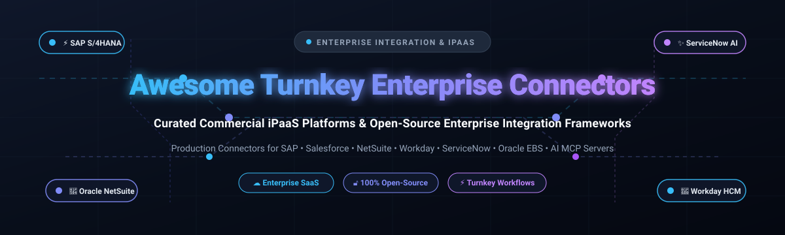

# Awesome Turnkey Enterprise System Connectors

  

  
  
  
  
  
  

> 🌐 A curated directory of top **Turnkey Enterprise System Connectors** and **Integration Platform as a Service (iPaaS)** solutions — featuring SaaS/hosted enterprise platforms and battle-tested open-source connector frameworks for production-grade integrations across SAP, Salesforce, NetSuite, Workday, ServiceNow, and Oracle.
> 
> 🌟 **Star this repo if you find it helpful!** 🌟

---

## 📋 Table of Contents

- [📈 Sector Overview & Market Dynamics](#-sector-overview--market-dynamics)
- [🟦 SaaS / Hosted Platforms](#-saas--hosted-platforms)
- [🟩 Open-Source Software](#-open-source-software)
- [🔍 Detailed SaaS Profiles](#-detailed-saas-profiles)
- [🛠️ Detailed Open-Source Profiles](#️-detailed-open-source-profiles)
- [📊 Comparison at a Glance](#-comparison-at-a-glance)
- [⭐ Star History](#-star-history)
- [💖 Support & Sponsorship](#-support--sponsorship)
- [🤝 Contributing](#-contributing)
- [📄 License](#-license)

---

## 📈 Sector Overview & Market Dynamics

The global Integration Platform as a Service (iPaaS) and enterprise connectors market reached approximately **$8.5 billion in 2024** and is projected to expand beyond **$18 billion to $21 billion by 2026** (growing at a ~23–28% CAGR), propelled by multi-cloud sprawl, hybrid ERP modernization, and agentic AI/MCP workflow orchestration. The sector operates as a **fragmented market with consolidated leadership**: while hyper-scalers and established enterprise software titans (Microsoft, Salesforce/MuleSoft, Oracle, Boomi) capture the bulk of Global 2000 multi-system core transformations, hundreds of specialized iPaaS, low-code automation, and open-source ELT/event-driven vendors aggressively compete and thrive across mid-market, verticalized, and developer-first niches.

---

## 🟦 SaaS / Hosted Platforms

Below is an overview of leading turnkey enterprise system connector platforms, sorted in descending order by parent company scale (market capitalization or latest enterprise valuation).

| 🏢 Platform / Vendor | 📊 Company Size (Market Cap / Valuation / ARR) | 💰 Starting Tier Pricing | ⏳ Free Tier / Free Trial Limits | 🔗 Key Target Integrations |
| :--- | :--- | :--- | :--- | :--- |
| **[Microsoft Power Platform](#microsoft-power-platform-connectors)** | 🌐 ~$3.8T+ Market Cap | **$15/user/month** (Power Automate Premium) or **$150/bot/month** (Process Plan) | **90-day free trial** with access to premium connectors & 250 MB Dataverse database capacity | SAP, Salesforce, ServiceNow, Dynamics 365, Workday |
| **[Oracle Integration Cloud (OIC)](#oracle-integration-cloud-adapters)** | 🌐 ~$370B+ Market Cap | **$0.65/hour** (~$475/month) for Standard Edition (1 message pack = 5,000 msgs/hr) | **30-day trial** ($300 cloud credits) + Oracle Cloud Free Tier (2 Autonomous DBs, up to 20 GB) | Oracle Cloud ERP/HCM/CX, Salesforce, SAP, Workday, ServiceNow |
| **[MuleSoft Anypoint Exchange](#mulesoft-anypoint-exchange)** | 🌐 ~$180B+ Market Cap (Salesforce) | **$2,000/month** (~$24,000/year billed annually, Entry Integration Starter) | **30-day free trial** (CloudHub sandbox, API Manager, local Anypoint Studio IDE) | SAP (BAPI/IDoc), Salesforce, NetSuite, Workday, ServiceNow |
| **[Workato Enterprise Connectors](#workato-enterprise-connectors)** | 🦄 $5.7B Valuation (~$150M+ ARR) | **~$1,667/month** (~$20,000/year billed annually, base workspace + recipe/task packs) | **15-day free trial** (unlimited trial workspace testing, sandboxed recipes & pre-built connectors) | Oracle EBS, SAP S/4HANA, NetSuite REST, Workday, Slack MCP |
| **[Icertis Enterprise Adapters](#icertis-pre-built-enterprise-adapters)** | 🦄 ~$5.0B Valuation (~$350M ARR) | **~$2,500/month** (~$30,000+/year quote-based enterprise contract starting tier) | **Sales-led PoC demo only** (no self-serve free trial; tailored sandboxed pilot upon request) | SAP ERP/Ariba, Salesforce, Microsoft Dynamics, Workday, DocuSign |
| **[Boomi Enterprise Connectors](#boomi-enterprise-connectors)** | 🏢 $4.0B PE Valuation (TPG / Francisco Partners) | **~$1,000/month** (~$12,000/year billed annually, Standard Edition base connector tier) | **30-day free trial** (full access to AtomSphere platform, pre-built connectors, and build environment) | SAP (RFMs, IDocs), NetSuite, Salesforce, Workday, Snowflake |
| **[SnapLogic Intelligent Connectors](#snaplogic-intelligent-connectors)** | 🦄 $1.0B Valuation (~$150M+ ARR) | **~$833/month** (~$9,995/year billed annually, starter integration package) | **30-day guided trial** via CSM / Sales (self-serve trial requires assisted demo activation) | SAP, Microsoft Dynamics 365, Workday, Coupa, Google BigQuery |
| **[Celigo Marketplace](#celigo-marketplace)** | 📈 ~$150M ARR (Venture-backed) | **~$1,250/month** (~$15,000/year billed annually, Standard integrator.io subscription) | **Free Forever Edition** (up to 2 endpoints and 1 active flow) after a **30-day unlimited trial** | NetSuite, Shopify, Salesforce, Amazon, Jira, HubSpot |
| **[Jitterbit Harmony Connectors](#jitterbit-connectors)** | 📈 ~$105M ARR (Audax Private Equity) | **~$850/month** (~$10,000/year billed annually, Standard 2-endpoint connector package) | **14-day free trial** (unrestricted sandbox access to Harmony design studio & pre-built connectors) | Salesforce, NetSuite, SAP, Apttus CPQ, Microsoft Dynamics |

---

## 🟩 Open-Source Software

Self-hosted, developer-friendly open-source connector frameworks and integration engines. Ranked in descending order by GitHub stargazers.

| 📦 Project | ⭐ GitHub_Stars | 💻 Language / Tech Stack | 📜 License | 🎯 Primary Architectural Focus |
| :--- | :--- | :--- | :--- | :--- |
| **[n8n](https://github.com/n8n-io/n8n)** |  | TypeScript / Node.js | Fair-code (Sustainable Use License) | Visual workflow automation with 400+ turnkey SaaS and enterprise nodes |
| **[Activepieces](https://github.com/activepieces/activepieces)** |  | TypeScript / Node.js | MIT | Extensible open-source no-code connector platform & business workflow engine |
| **[Airbyte](https://github.com/airbytehq/airbyte)** |  | Java / Python | MIT / Elastic-2.0 | ELT data replication engine with 350+ pre-built connectors and custom CDK |
| **[CloudQuery](https://github.com/cloudquery/cloudquery)** |  | Go | MPL-2.0 | High-performance open-source ELT framework extracting enterprise SaaS/cloud configs |
| **[Apache Camel](https://github.com/apache/camel)** |  | Java | Apache-2.0 | Enterprise Integration Patterns (EIP) framework with 350+ production connectors |
| **[dlt (data load tool)](https://github.com/dlt-hub/dlt)** |  | Python | Apache-2.0 | Lightweight Python library for loading unstructured and REST API data into warehouses |
| **[Ballerina](https://github.com/ballerina-platform/ballerina-lang)** |  | Ballerina / Java | Apache-2.0 | Cloud-native programming language purpose-built for enterprise integration & APIs |
| **[Meltano](https://github.com/meltano/meltano)** |  | Python | Apache-2.0 | CLI-driven ELT framework powered by the Singer tap & target connector ecosystem |
| **[Singer](https://github.com/singer-io/getting-started)** |  | Python | Apache-2.0 | Open-source standard for composable ETL/ELT data extraction taps and targets |

---

## 🔍 Detailed SaaS Profiles

### 🖥️ Microsoft Power Platform Connectors
* **Company Size:** ~$3.8T+ Market Capitalization (Microsoft Corp.)
* **Type:** Enterprise connector catalog embedded across Power Automate, Power Apps, and Copilot Studio.
* **Pricing & Free Limits:** Starts at **$15/user/month** for Power Automate Premium or **$150/bot/month** for Power Automate Process. Standard connectors are bundled with Office 365, while a 90-day trial provides full access to premium enterprise connectors and 250 MB Dataverse capacity.
* **Overview:** Provides 1,000+ connectors spanning core ERP/CRM backbones (SAP ERP, Salesforce, ServiceNow) down to cloud utilities. Microsoft is rapidly introducing MCP (Model Context Protocol) server connectors to power autonomous AI agent workflows directly across enterprise datasets.
* **Best For:** Enterprises standardized on Microsoft Azure, Office 365, and Dynamics 365 seeking deep low-code native connectors.

### 🔴 Oracle Integration Cloud (OIC)
* **Company Size:** ~$370B+ Market Capitalization (Oracle Corp.)
* **Type:** Managed cloud integration platform and prebuilt enterprise application adapters.
* **Pricing & Free Limits:** Metered by message packs starting at **~$0.65/hour** (~$475/month) for Standard Edition (5,000 messages/hour). Offers a 30-day trial with $300 cloud credits alongside Oracle Cloud Always Free services.
* **Overview:** Features enterprise adapters and pre-packaged integration recipes connecting Oracle Fusion Cloud ERP, HCM, and CX with Salesforce, Workday, SAP, and ServiceNow, backed by embedded process automation and B2B/EDI transaction handling.
* **Best For:** Large enterprises centering their business processes around Oracle Cloud Applications and hybrid on-premises Oracle databases.

### ☁️ MuleSoft Anypoint Exchange
* **Company Size:** ~$180B+ Market Capitalization (Salesforce Inc.)
* **Type:** Governed enterprise integration marketplace, runtime platform, and API registry.
* **Pricing & Free Limits:** Starter tiers begin at **~$2,000/month** (annual commitment, billed as Mule Credits). Provides a **30-day free trial** for CloudHub and API Manager evaluation, with the desktop IDE (Anypoint Studio) freely downloadable.
* **Overview:** MuleSoft offers battle-tested connectors for SAP (BAPIs, RFMs, IDocs), NetSuite, Salesforce, Workday, and IBM mainframes. Its Anypoint Exchange acts as a governed internal marketplace where teams share API specifications, connector blueprints, and autonomous AI agent tool definitions.
* **Best For:** Large corporations demanding API-led connectivity, rigorous microservices governance, and multi-cloud runtime management.

### ⚡ Workato Enterprise Connectors
* **Company Size:** $5.7B Valuation (~$150M+ ARR)
* **Type:** Enterprise automation iPaaS with AI-enabled recipes and connector registry.
* **Pricing & Free Limits:** Base workspace packages begin around **~$20,000/year** (~$1,667/month) plus recipe/task packs. Offers a **15-day free sandbox trial** with complete access to pre-built application connectors.
* **Overview:** Features deep connectors into Oracle EBS, SAP Ariba, NetSuite REST, and Workday, coupled with pre-built MCP servers for autonomous agents (Slack, Gong, Jira, GitHub) to orchestrate bi-directional enterprise business workflows.
* **Best For:** Fast-moving mid-market and enterprise organizations pairing IT-governed integrations with business-user self-service automation.

### 📜 Icertis Pre-built Enterprise Adapters
* **Company Size:** ~$5.0B Valuation (~$350M ARR)
* **Type:** Contract Lifecycle Management (CLM) enterprise system integration adapters.
* **Pricing & Free Limits:** Enterprise contract subscriptions typically start at **~$30,000+/year** (~$2,500/month). No open public free trial; evaluation requires a sales-guided proof-of-concept (PoC).
* **Overview:** Seamlessly connects contract intelligence pipelines into SAP ERP/Ariba, Salesforce Sales Cloud, Workday Human Capital, and Microsoft Dynamics 365, turning contract repositories into active operational data feeds.
* **Best For:** Legal, procurement, and sales ops teams requiring deep contract-to-ERP and contract-to-CRM bi-directional data synchronization.

### 🌐 Boomi Enterprise Connectors
* **Company Size:** $4.0B Acquisition Valuation (TPG & Francisco Partners)
* **Type:** Cloud-native enterprise iPaaS and distributed runtime Atom engine.
* **Pricing & Free Limits:** Base Standard packages begin around **~$1,000/month** (~$12,000/year). Offers a **30-day fully functional free trial** of the AtomSphere integration platform.
* **Overview:** Connects over 300,000 endpoints worldwide, featuring deeply certified connectors for SAP, NetSuite, Salesforce, Workday, and leading cloud data warehouses (Snowflake, Databricks). Distributed Atoms can execute behind on-premises corporate firewalls.
* **Best For:** Hybrid multi-cloud enterprises needing reliable on-prem-to-cloud connectivity and high-throughput EDI/B2B data flows.

### 🔄 SnapLogic Intelligent Connectors
* **Company Size:** $1.0B Valuation (~$150M+ ARR)
* **Type:** Visual integration pipeline platform powered by modular "Snap Packs".
* **Pricing & Free Limits:** Baseline subscriptions start at **~$9,995/year** (~$833/month). Free trials are coordinated through customer success and enterprise sales demos for 30 days.
* **Overview:** Provides 500+ pre-built Snaps covering ERPs (SAP, Dynamics 365), databases (Cassandra, Snowflake, BigQuery), and modern GenAI LLM orchestration utilities for enterprise Retrieval-Augmented Generation (RAG).
* **Best For:** Data engineering and enterprise IT teams seeking drag-and-drop pipeline construction across streaming, batch, and AI workflows.

### 📦 Celigo Marketplace
* **Company Size:** ~$150M Annual Revenue (Privately Held)
* **Type:** iPaaS and managed turnkey integration applications (Integration Apps).
* **Pricing & Free Limits:** Commercial subscriptions start around **~$15,000/year** (~$1,250/month). Offers a **Free Forever Edition** (supporting 2 endpoints and 1 flow) following a **30-day full-access trial**.
* **Overview:** Renowned for turn-key "Integration Apps" that automate end-to-end business workflows like Order-to-Cash, Procure-to-Pay, and Payroll synchronization across NetSuite, Salesforce, Shopify, and Amazon.
* **Best For:** Mid-market e-commerce, retail, and NetSuite-centric corporations seeking pre-packaged, self-healing integration business logic.

### 🔗 Jitterbit Connectors
* **Company Size:** ~$105M ARR (Audax Private Equity)
* **Type:** Low-code iPaaS, API gateway, and EDI integration suite.
* **Pricing & Free Limits:** Entry tiers start around **~$850/month** (~$10,000/year) based on connection endpoints. Provides a **14-day free trial** of the Jitterbit Harmony platform.
* **Overview:** Combines low-code application connectivity (Salesforce, SAP, NetSuite, Apttus) with native EDI partner management and low-code app development tools.
* **Best For:** Organizations seeking unified API management, legacy EDI trading partner translation, and SaaS connectors under a single roof.

---

## 🛠️ Detailed Open-Source Profiles

### 🤖 n8n
* **GitHub:**  | **License:** Sustainable Use License / Fair-code
* **Stack:** TypeScript, Node.js, Vue.js, Docker
* **Overview:** An extremely popular fair-code workflow automation engine with 400+ built-in application connectors. Supports visual workflow modeling, custom JavaScript/Python execution nodes, native AI agent integration nodes, and on-premises hosting.
* **Best For:** Self-hosters and developer teams needing low-friction, node-based automation between SaaS services and internal databases.

### 🧩 Activepieces
* **GitHub:**  | **License:** MIT
* **Stack:** TypeScript, Node.js, Angular, Docker
* **Overview:** A modular, open-source Zapier/Workato alternative featuring 200+ pre-built connector "pieces". Completely community-extensible with an npm-published framework for writing custom enterprise pieces.
* **Best For:** Organizations looking for a clean, modern MIT-licensed no-code automation platform with full white-label and embed capabilities.

### 🚚 Airbyte
* **GitHub:**  | **License:** MIT (Core connectors) / Elastic License 2.0
* **Stack:** Java, Python, React, Docker, Kubernetes
* **Overview:** The de-facto open-source ELT data replication platform with 350+ out-of-the-box connectors for databases, SaaS endpoints, and warehouse targets. Features an intuitive Connector Development Kit (CDK) allowing developers to create connectors within hours.
* **Best For:** Data engineering teams centralizing corporate operational data from enterprise applications into Snowflake, BigQuery, ClickHouse, or Postgres.

### 🔍 CloudQuery
* **GitHub:**  | **License:** MPL-2.0
* **Stack:** Go, SQL, gRPC
* **Overview:** A high-performance, open-source ELT framework that extracts APIs, cloud infrastructure, and enterprise SaaS configurations into standard SQL databases and data lakes for analytics, cybersecurity, and audit compliance.
* **Best For:** DevOps, SecOps, and data engineers extracting deep state and configuration data from hundreds of cloud and SaaS services into queryable SQL.

### 🐫 Apache Camel
* **GitHub:**  | **License:** Apache-2.0
* **Stack:** Java, YAML, XML, Quarkus, Spring Boot, Kubernetes
* **Overview:** The gold standard in open-source enterprise integration, implementing standard Enterprise Integration Patterns (EIP). Offers over 350+ production-tested components connecting to SAP, Salesforce, Kafka, IBM MQ, JMS, and NetSuite.
* **Best For:** Enterprise Java architects and engineering organizations building custom, mission-critical integration microservices.

### 📥 dlt (data load tool)
* **GitHub:**  | **License:** Apache-2.0
* **Stack:** Python, DuckDB, Arrow
* **Overview:** A lightweight, developer-first Python library that loads arbitrary JSON and REST API data structures into databases, data lakes, or vector stores with automatic schema inference and evolution.
* **Best For:** Python engineers building bespoke data pipelines and connector scripts without running heavy external server infrastructure.

### 🩰 Ballerina
* **GitHub:**  | **License:** Apache-2.0
* **Stack:** Ballerina, Java, LLVM
* **Overview:** An open-source programming language developed by WSO2 specifically designed for cloud-native integration. Features sequence diagrams as core syntax and a comprehensive package ecosystem of enterprise connectors (Salesforce, SAP, AWS, Azure).
* **Best For:** Teams wanting to write testable, maintainable, compiled integration microservices without the overhead of heavy XML or drag-and-drop UIs.

### 🛠️ Meltano
* **GitHub:**  | **License:** Apache-2.0
* **Stack:** Python, Singer, dbt, Airflow
* **Overview:** A declarative, CLI-driven ELT framework that bundles Singer taps and targets into version-controlled, GitOps-ready data pipelines integrated with dbt for transformation.
* **Best For:** Data engineering teams committed to code-first, GitOps-driven data synchronization pipelines.

### 🎤 Singer
* **GitHub:**  | **License:** Apache-2.0
* **Stack:** Python, JSON Schema
* **Overview:** The open-source data extraction standard defining unix-style composable "taps" (data extractors) and "targets" (data loaders) that communicate over standard streams.
* **Best For:** Developers desiring lightweight, modular UNIX-pipe CLI tools for replicating records between disparate APIs and databases.

---

## 📊 Comparison at a Glance

| 🛠️ Solution | 🌐 Deployment | 🏛️ Architecture | 🔌 Pre-Built Enterprise Connectors | 📋 Turnkey Flow Templates | 💻 Self-Hosted | 🛡️ Governance & Auditing |
| :--- | :--- | :--- | :--- | :--- | :--- | :--- |
| **Microsoft Power Platform** | Managed Cloud | Low-Code / RPA / AI | ✅ 1,000+ | ✅ Vast Library | ❌ | ✅ Enterprise Admin Center |
| **Oracle Integration Cloud** | Managed Cloud | iPaaS / Process Engine | ✅ Oracle & Third-Party | ✅ Prebuilt Recipes | ❌ | ✅ Cloud OCI Governance |
| **MuleSoft Anypoint** | Hybrid / Cloud | API-Led iPaaS | ✅ 300+ Enterprise | ✅ Templates & Specs | ❌ (Runtime on-prem) | ✅ Advanced API Governance |
| **Workato** | Managed Cloud | Event Automation / MCP | ✅ 1,000+ Apps & ERPs | ✅ Pre-built Recipes | ❌ | ✅ Role-based Workspace Controls |
| **Icertis Adapters** | Managed Cloud | Contract-Centric iPaaS | ✅ SAP, SFDC, Workday | ✅ Pre-packaged | ❌ | ✅ Contract Audit Trail |
| **Boomi** | Hybrid / Cloud | Distributed Atom iPaaS | ✅ 300,000+ Endpoints | ✅ Process Blueprints | ❌ (Atom on-prem) | ✅ AtomSphere Governance |
| **SnapLogic** | Hybrid / Cloud | Visual Flow Snaplex | ✅ 500+ Snap Packs | ✅ Pipelines | ❌ (Snaplex on-prem) | ✅ SnapLogic Monitoring |
| **Celigo** | Managed Cloud | Turnkey iPaaS | ✅ NetSuite, Shopify, ERP | ✅ Integration Apps | ❌ | ✅ Real-time Error Diagnostics |
| **Jitterbit Harmony** | Hybrid / Cloud | iPaaS / API Gateway | ✅ Comprehensive | ✅ Process Templates | ❌ (Agent on-prem) | ✅ API Management & Logs |
| **n8n** | Self-Hosted / Cloud | Visual Low-Code Engine | ✅ 400+ Nodes | ✅ Community Templates | ✅ | ✅ Execution Audit Logs |
| **Activepieces** | Self-Hosted / Cloud | Low-Code Automation | ✅ 200+ Pieces | ✅ Community Workflows | ✅ | ✅ Admin Dashboard |
| **Airbyte** | Self-Hosted / Cloud | ELT Data Replication | ✅ 350+ Sources | ✅ Turnkey Connectors | ✅ | ✅ Sync Logs & Metrics |
| **CloudQuery** | Self-Hosted / CLI | High-Throughput ELT | ✅ Cloud & SaaS APIs | ✅ Plugin Schemas | ✅ | ✅ Config as Code |
| **Apache Camel** | Self-Hosted | Code-First EIP Framework | ✅ 350+ Components | ❌ (Engineered in code) | ✅ | ✅ OpenTelemetry & Metrics |
| **dlt (data load tool)** | Self-Hosted / Library | Python Data Loading | ✅ 50+ Source Connectors | ❌ (Custom Python) | ✅ | ✅ Schema Tracking |
| **Ballerina** | Self-Hosted | Integration Language | ✅ 100+ Connectors | ❌ (Programmed in Ballerina) | ✅ | ✅ Native Tracing & Observability |
| **Meltano** | Self-Hosted / CLI | CLI DataOps Framework | ✅ Singer Ecosystem | ✅ Meltano Hub | ✅ | ✅ GitOps Versioning |
| **Singer** | Self-Hosted / CLI | Unix Streams Protocol | ✅ Community Taps | ❌ (Piped streams) | ✅ | ✅ Stream Logs |

---

## 📈 Star History

---

## 💖 Support & Sponsorship

If you find this curated list of turnkey enterprise system connectors valuable, please consider supporting its ongoing research and maintenance!

- ⭐ **Star & Fork:** Give this repository a star and share it across tech communities, LinkedIn, and Twitter/X.
- ☕ **Buy a Coffee / Sponsor:** Support ongoing open-source maintenance via the [GitHub Sponsors Dashboard](https://github.com/sponsors/ishandutta2007).
- 💬 **Community:** Join discussions on our [Discord Community](https://discord.gg/jc4xtF58Ve) and connect with integration architects and engineers.

Thank you for powering open-source enterprise integration! 🙏

---

## 🤝 Contributing

Contributions are warmly welcomed! If you maintain or use an enterprise system connector, open-source integration framework, or iPaaS tool that belongs here, please submit a Pull Request.

### 📝 Submission Guidelines:
1. Ensure the platform is actively maintained (commits or release updates within the past 12 months).
2. Follow alphabetical or star-sorted ordering in appropriate sections.
3. Include specific licensing terms, tech stack, and primary connector specialties.
4. Keep descriptions factual, concise, and focused on enterprise integration capabilities.

---

## 📄 License

This repository and curated list are released under the [Creative Commons Zero v1.0 Universal License (CC0 1.0)](LICENSE) - Public Domain Dedication.

---

⭐ **Found this guide helpful? Please star the repository to support the community!** ⭐
